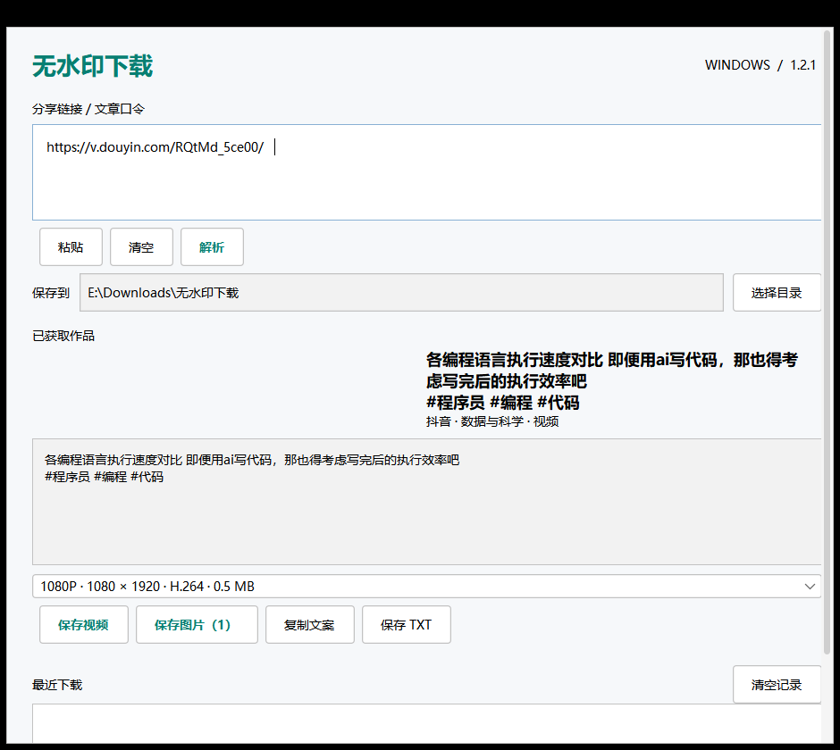

# Free High-definition Download

**无水印下载 | Android APK + Windows EXE**

[中文](#中文) · [English](#english) · [下载 / Download](https://github.com/zw0927/Free-High-definition-download/releases/latest) · [Apache-2.0](LICENSE)

保存抖音、小红书、B站公开作品中的视频、图片和文字。粘贴分享内容，选择平台实际提供的画质，保存到自己的设备。

Save videos, images and text from supported public Douyin, Xiaohongshu and Bilibili posts. Paste a share link, choose an available quality and save locally.

> “高清 / 无水印”表示优先选择平台实际返回的原片或无水印播放源，不保证每条作品都有高清源，不移除已经嵌入画面的水印。
>
> “HD / watermark-free” means selecting available original or unwatermarked sources. Resolution depends on the source; embedded watermarks are not removed.



## 中文

### 下载与安装

前往 [GitHub Releases](https://github.com/zw0927/Free-High-definition-download/releases/latest)：

| 设备 | 安装包 | 使用方式 |
| --- | --- | --- |
| Android 8.0 及以上 | `FreeHDDownload-1.2.4-android.apk` | 下载并安装 APK；原“无水印下载”用户可覆盖升级 |
| Windows 10 / 11 x64 | `FreeHDDownload-1.2.4-windows-x64.zip` | 完整解压，双击 `FreeHDDownload.exe`；无需安装 Java |
| iPhone / iPad / macOS | 暂无 | 当前不提供这些系统的客户端或网页版 |

Windows 请保留 EXE 旁边的 `app` 和 `runtime` 文件夹。便携版未购买商业代码签名证书，首次运行可能出现未知发布者或 SmartScreen 提示；请核对发布来源和校验和，不需要关闭系统防护。当前应用界面为中文。

### 功能

- 抖音：普通视频、图集、文案和长文章；识别完整分享链接及支持的文章口令。
- 小红书：公开视频原片、图文笔记、正文及封面；需保留完整分享参数。
- 抖音和小红书图集支持实况图。选择“保存静态照片和动态视频”，照片与 MP4 按原顺序配对保存；原生 GIF 和动态 WebP 保留原格式。
- 实况图同时保存静态照片与同序号动态 MP4；若动态视频没有音轨，保留静音 MP4 并提示。
- 图片依据文件签名识别 JPEG、PNG、GIF、WebP、HEIC、HEIF 和 AVIF，按原格式保存。
- B站：普通 BV / av / b23.tv 链接和分P，本地合并视频与音频。
- B站登录：Windows 扫码，Android 官方登录页；保留本机登录状态后获取账号可用画质。小红书图片使用原图 CDN，避免下载带平台水印的 H5 展示图。
- 选择实际可用的画质，不放大低清视频冒充高清。
- 复制文案、保存 UTF-8 TXT；文章 TXT 保留 Markdown 的标题、段落和链接。
- Android 保存视频和图片到公共相册；Windows 可选择保存目录。
- 查看下载记录、打开文件、清空记录和取消下载。

### 使用方法

1. 在原平台复制作品分享链接或完整分享文案。
2. 打开应用并点击“粘贴”；停止输入约0.9秒后自动解析，也可点击“解析”。Android 支持通过系统分享菜单发送文字到本应用。
3. 解析成功后检查标题和作者。视频选择画质，图集选择保存图片，文章选择复制正文或保存 TXT。
4. Android 在相册“无水印下载”文件夹查看媒体；Windows 在所选目录查看，也可从最近下载打开。

实况图图集会为每张实况照片分别保存静态照片和动态 MP4。平台没有提供动态源时仍保留静态照片并提示。MP4 有音轨时原样保留；没有音轨时也保存并提示，不会凭空生成声音。

未解析时不显示文字导出按钮。清空记录不删除已经下载的文件。批量图片中途取消或失败时，已完成图片保留。

### B站高清下载（1.2.2）

点击“B站登录”。Windows 使用手机哔哩哔哩 App 扫描官方二维码并确认；Android 在官方登录页完成登录。返回后重新解析视频，选择返回的高清档位并保存。登录状态保留在本机，后续解析自动使用；可从同一入口退出。平台会话失效时需要重新登录。

匿名访问经常只有 360P / 480P。登录后通常能获得普通 1080P，最终以账号权限和作品返回的视频轨道为准；1080P 高码率、4K 等档位可能需要相应会员权限。应用下载并直接合并平台视频与音频，不放大画面，也不能取得平台未公开提供的作者上传母版。

1.2.4 提供 Android 签名 APK 与 Windows EXE 便携包。Android 沿用原包名与升级签名。

### 平台限制

| 平台 | 支持范围 | 限制 |
| --- | --- | --- |
| 抖音 | 返回的视频、图集、文章正文 | 私密、已删除、登录限制和平台风控可能导致失败；文章不是 MP4 |
| 小红书 | 含完整访问参数的公开分享内容；图片使用原图 CDN | 保留 `xsec_token`；原图失败时不退回带平台水印的 H5 展示图；实况字段可能随平台页面变更 |
| B站 | 公开普通视频、分P、账号可用画质及音视频合并 | 高清可能需要登录或相应会员权限；不能移除源画面里的账号和 bilibili 标识 |

不支持绕过付费、会员、DRM 或私密访问限制。不对视频或图片做裁剪、模糊、画面修复或重编码去水印。请仅下载有权保存的内容，转载和商用前取得授权。

### 服务器与隐私

普通分享链接在用户设备上解析和下载，不需要部署本项目的后端，也没有账号系统。

可选 B站登录直接连接 B站官方服务。登录 Cookie 仅用于 B站 API；Windows 保存于本机 `settings.properties`，Android 保存于应用私有设置与 WebView Cookie。不要将这些个人设置文件上传或分享。退出登录会移除应用保存的凭据。

**无网址的抖音文章口令例外**：提取出的公开口令会发送到 `https://parse-api.sokoko.org/api/douyin/resolve`，由第三方服务转换作品编号，再直接从抖音取正文。不会将整段分享文案或平台 Cookie 发给该服务。服务可能失效、限流或停止；可改用作品网页链接。本项目不运营该服务，也不承诺其可用性。

Windows 在 `%LOCALAPPDATA%\FreeHDDownload` 保存设置、下载记录和合并临时文件；媒体最终保存在用户选定目录。临时文件在正常结束、失败或取消时清理，强制终止可能遗留文件。Android TXT 使用系统文件选择器。

默认设置目录不可写时，Windows 会退回当前工作目录下的 `FreeHDDownload-data`；若该目录也不可写，会显示错误。B站合并的临时轨道位于用户选择的保存目录，完成后删除。

### 构建

当前脚本面向 Windows PowerShell。Windows 使用可再分发的 Temurin 17；Android 需要 JDK 17，默认路径见 `build.ps1`。

```powershell
git clone https://github.com/zw0927/Free-High-definition-download.git
cd Free-High-definition-download

# Windows：下载并校验 Temurin，再构建便携版。
.\desktop\setup.ps1
.\desktop\build.ps1

# Android：准备 Android SDK 35，测试并构建。
.\tools\setup.ps1
.\tests\run.ps1
.\build.ps1
```

Windows 复用现有 Java 解析核心，新增桌面 UI、文件保存和 MP4 合并。依赖从 Maven Central 下载：JSON-java、mp4parser、AspectJ、SLF4J、FlatLaf、ZXing。发行包附带 Temurin 精简运行环境，不附带 FFmpeg。

Android 私钥不在仓库中。首次本机构建会生成开发密钥，不能覆盖安装由其他密钥签名的 APK；正式发布者应自行保管密钥。原升级密钥仅保留在维护者本机，不包含在源码 ZIP、Git 或 Release 中。

再次使用已有密钥构建时，先设置环境变量 `FHD_KEYSTORE_PASSWORD`；首次生成的本机开发密钥口令为 `android-development-only`，仅供开发，不应当作正式分发密钥。

若本机 Temurin `jpackage` 无法写入输出目录，可使用其他 JDK 17 的打包工具：`.\desktop\build.ps1 -Packager 'C:\path\to\jdk-17\bin\jpackage.exe'`。发行运行环境仍由 Temurin `jlink` 生成。

### 验证与贡献

Windows 已实际验证抖音视频和图片下载、B站音视频下载和本地合并，并检查成片含视频及音频轨道。桌面界面完成截图检查。文章口令已取得匹配的完整正文。平台变化仍可能导致后续失败。

Android 编译、对齐和签名检查通过；尚未完成真机安装、相册写入和系统 TXT 保存验证。完整记录见 [VALIDATION.md](VALIDATION.md)，修改清单见 [CHANGES.md](CHANGES.md)。

欢迎 Issue / Pull Request。请提供版本、系统、平台、可公开复现的链接和错误信息；不要公开 Cookie、凭据或私密内容。

源代码采用 [Apache-2.0](LICENSE)，第三方组件遵守其各自许可证，见 [NOTICE](NOTICE)、[第三方说明](assets/THIRD_PARTY_NOTICES.txt)、`assets/licenses/` 和 Windows 包的 `runtime/legal/`。

参考：[F2](https://github.com/Johnserf-Seed/f2)、[yt-dlp](https://github.com/yt-dlp/yt-dlp)、[nonebot-plugin-parser-lite](https://github.com/sokoko-org/nonebot-plugin-parser-lite)、[mp4parser](https://github.com/sannies/mp4parser)、[FlatLaf](https://github.com/JFormDesigner/FlatLaf)。本项目与内容平台无隶属或官方合作关系。

## English

### Download and Install

Get the current build from [GitHub Releases](https://github.com/zw0927/Free-High-definition-download/releases/latest).

| Platform | Package | Installation |
| --- | --- | --- |
| Android 8.0+ | `FreeHDDownload-1.2.4-android.apk` | Install the APK; releases retain the original app package and signing key |
| Windows 10 / 11 x64 | `FreeHDDownload-1.2.4-windows-x64.zip` | Extract everything and run `FreeHDDownload.exe`; Java is included |
| iOS / iPadOS / macOS | Not available | No client or web version is currently provided |

Keep the `app` and `runtime` folders beside the EXE. Windows builds are unsigned and may trigger SmartScreen. Verify release sources and checksums; disabling system protection is not required. The app interface is currently Chinese; this README is bilingual.

### Features and Usage

- Douyin public videos, photo posts, captions and articles, including supported URL-less article commands.
- Xiaohongshu original video sources, photo posts, captions and covers when provided by the platform.
- Douyin and Xiaohongshu Live Photo motion is saved as MP4. Native GIF and animated WebP files retain their original format.
- Live Photo downloads include both the still image and motion MP4. Source clips without an audio track are kept silent and reported.
- Identify and preserve JPEG, PNG, GIF, WebP, HEIC, HEIF and AVIF files by their signatures.
- Bilibili ordinary BV / av / b23.tv links, multipart selection and local audio/video muxing.
- Version 1.2.2 adds optional Bilibili login for account-accessible quality and original Xiaohongshu image CDN sources instead of watermarked H5 display images.
- Select available resolution, save media locally, copy captions and export UTF-8 TXT.
- Choose a Windows destination or use Android's public gallery; manage history and cancel transfers.

1. Copy the complete share link or message from the original platform.
2. Paste it into the app. Parsing starts after approximately 0.9 seconds, or press the parse button. Android also accepts text through the system share menu.
3. Check the title and author. Choose video quality, save images, or copy/export article text.
4. Open the chosen Windows folder or Android's `无水印下载` gallery album.

Text export controls appear after successful parsing. Articles retain Markdown headings, paragraphs and links in TXT; they are not converted into fabricated MP4 videos. Clearing history does not delete media. Completed images remain after an interrupted batch.

For Bilibili HD in 1.2.2, click `B站登录`. On Windows, scan the official QR using the Bilibili mobile app and confirm; Android opens the official login page. Parse the video again after login and choose an available quality. The session is retained locally and can be removed from the same account button. Expired sessions require login again. Anonymous playback may be limited to 360p/480p; ordinary 1080p generally requires login, while higher tiers may require membership. The app preserves the supplied streams without upscaling or re-encoding; the uploader's original master is not available unless the platform exposes it.

Live Photo galleries save the still image and matching motion MP4. If the source has an audio track, it is retained; otherwise the silent MP4 is kept with a notice. When motion is unavailable, the still image is still saved.

Version 1.2.4 includes a signed Android APK and a portable Windows package. The APK retains the original package name and signing certificate.

### Limitations

Resolution depends on platform responses and account access. Some Bilibili streams contain an embedded creator name or bilibili logo; these pixels are retained. Xiaohongshu needs complete parameters such as `xsec_token`; missing originals produce an error rather than a silent fallback to possibly watermarked streams.

No paid, members-only, DRM or private-access restrictions are bypassed. The app does not crop, blur, inpaint or re-encode to erase embedded marks. Download only material you are entitled to save; obtain authorization before redistribution or commercial use.

### Network and Privacy

Ordinary links are parsed and downloaded on-device. No project backend or account is required.

Optional Bilibili login connects directly to official Bilibili services. Session cookies are used only for Bilibili APIs and retained locally in Windows settings or Android private preferences/WebView cookies. Do not share these settings files. Sign out through the account button to remove the stored session.

**Exception: URL-less Douyin commands.** The extracted public token is sent to the third-party endpoint `https://parse-api.sokoko.org/api/douyin/resolve` for an item ID. The full message and platform cookies are not sent. Content is then fetched directly from Douyin. This project does not operate the service or guarantee availability. Use a normal post URL when it is unavailable.

Windows stores settings, history and muxing temporary data under `%LOCALAPPDATA%\FreeHDDownload`. Final media goes to your chosen directory. Normal success, failure or cancellation removes temporary media; forced termination can leave files. Android TXT exports use the system picker.

### Build From Source

Use Windows PowerShell. Windows packaging downloads a redistributable Temurin 17 JDK and Maven dependencies. Android requires JDK 17 and Android SDK 35.

```powershell
git clone https://github.com/zw0927/Free-High-definition-download.git
cd Free-High-definition-download

# Windows portable EXE, bundled runtime
.\desktop\setup.ps1
.\desktop\build.ps1

# Android APK
.\tools\setup.ps1
.\tests\run.ps1
.\build.ps1
```

Android signing keys are excluded. A local first build generates a development key that cannot upgrade APKs signed by another key. Keep production keys outside Git. Windows shares the Java parser and uses mp4parser for muxing; no FFmpeg binary is bundled.

If Temurin's packager cannot write to an output directory on your system, use another JDK 17 packager through `desktop/build.ps1 -Packager 'C:\path\to\jdk-17\bin\jpackage.exe'`. The included runtime is still built from Temurin.

### Validation, License and Contributions

Windows tests include actual Douyin video/image downloads and Bilibili audio/video downloads with local muxing. The MP4 was checked for both tracks; desktop screenshots were inspected. Android compilation, alignment and signature verification passed, but device installation, gallery writes and TXT picker flows have not been verified. See [VALIDATION.md](VALIDATION.md) for evidence and remaining gaps.

Source code uses [Apache-2.0](LICENSE). Dependencies retain their own licenses; see [NOTICE](NOTICE), [third-party notices](assets/THIRD_PARTY_NOTICES.txt), `assets/licenses/` and `runtime/legal/` in Windows distributions. The project is not affiliated with Douyin, Xiaohongshu or Bilibili.

Issues and pull requests are welcome. Include version, OS, platform, a public reproducible link and the error. Never post cookies, credentials or private content.
